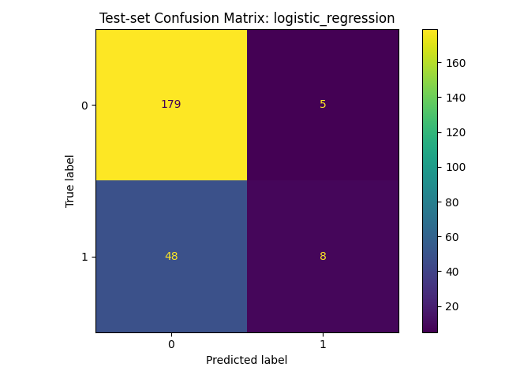

# Customer Churn Prediction & Retention Analytics

**Portfolio case study | Data Science / Business Analytics Internships**  
**Tools:** Python, pandas, scikit-learn, SQL (SQLite), Excel, machine learning, model evaluation

## Executive summary
This project explores predicting subscription customer churn from **synthetic customer records**. It trains logistic regression and random forest models, compares them with a majority-class baseline and exports held-out predictions for analysis.

### Model evaluation (held-out test data)
| Model | Accuracy | Precision | Recall | F1 | ROC-AUC |
|---|---:|---:|---:|---:|---:|
| Logistic regression | 0.779 | 0.615 | 0.143 | 0.232 | 0.758 |
| Random forest | 0.758 | 0.444 | 0.143 | 0.216 | 0.727 |
| Majority-class baseline | 0.767 | 0.000 | 0.000 | 0.000 | 0.500 |

Logistic regression achieved **0.758 ROC-AUC**, but only **14.3% recall** at the default 0.5 decision threshold. Thus most actual churners were missed. These results are not production-ready.

## Test-set confusion matrix


## Questions addressed
1. Can customer attributes help rank churn risk?
2. Does predictive modeling beat a majority-class baseline?
3. Which model limitations matter when deciding whom to contact?

## Method
- Stratified 80/20 train/test split with `random_state=42`.
- Remove `customer_id` from predictive features.
- Scale numeric features and one-hot encode contracts with a scikit-learn pipeline.
- Compare logistic regression and random forest using accuracy, precision, recall, F1 and ROC-AUC.
- Export test-set scores for model evaluation, **not live customer targeting**.

## Files
| File | Purpose |
|---|---|
| `analysis.py` | Data preparation, classification, validation and SQLite export |
| `data/sample_data.csv` | Synthetic customer sample |
| `sql/analysis.sql` | Exploratory SQL queries |
| `outputs/model_metrics.csv` | Model performance comparison |
| `outputs/test_predictions.csv` | Held-out test predictions |
| `outputs/churn.db` | Generated SQLite database |
| `figures/confusion_matrix.png` | Model diagnostic chart |
| `excel_report.xlsx` | Supporting Excel workbook (upload separately if absent) |
| `POWER_BI_GUIDE.md` | Dashboard design guidance, not a finished PBIX |

## Run locally
```bash
python3 -m pip install -r requirements.txt
python3 analysis.py
```

## Business interpretation
ROC-AUC measures discriminatory ranking, **not** guaranteed retention or profit uplift. A retention program would need an outreach threshold informed by capacity, customer value and intervention costs. Predicting churn does not establish that outreach prevents it.

## Limitations and next steps
The labels are **synthetically generated**, so the metrics are not evidence of real-world predictive performance. Future work: threshold tuning, calibration, class imbalance analysis, temporal validation and deployment monitoring. No interactive Power BI `.pbix` is included.
